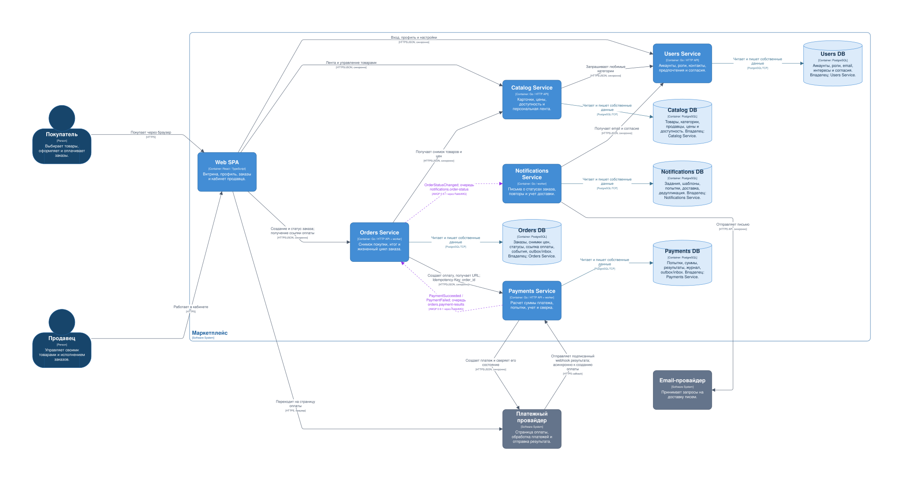

# Архитектура маркетплейса

Маркетплейс спроектирован как пять сервисов: Users, Catalog (каталог и лента),
Orders, Payments и Notifications. У каждого сервиса своя БД.
Продавцы управляют товарами, покупатели получают персональную ленту и оформляют
заказы, система учитывает платежи и отправляет уведомления.

## 1. Запуск

```sh
docker compose up --build --wait --wait-timeout 90
curl -i http://localhost:8080/health
```

Ответ:

```http
HTTP/1.1 200 OK
Content-Type: application/json

{"status":"ok"}
```

Остановка:

```sh
docker compose down
```

Стек сервиса: Go, OpenAPI 3.1, `oapi-codegen/v2` strict server, chi.
[Контракт API](api/openapi.yaml) · [Настройки генератора](internal/api/oapi-codegen.yaml).

После изменения контракта:

```sh
go generate ./...
go test ./...
```

## 2. C4 Container



[SVG](docs/architecture/c4-container.svg) ·
[PNG](docs/architecture/c4-container.png) ·
[Structurizr DSL](docs/architecture/workspace.dsl)


Сплошные стрелки — HTTP-вызовы или доступ к БД; пунктирные — сообщения
через RabbitMQ. Названия очередей указаны на связях.

Просмотр диаграммы: `make architecture-up`, затем <http://localhost:8081>.
Остановка: `make architecture-down`.

После изменения DSL обновите SVG и PNG:

```sh
make architecture-export
```

## 3. Предположения и границы кейса

- Один пользователь может иметь роли покупателя и продавца.
- Один заказ содержит товары одного продавца; покупки у нескольких продавцов
  оформляются отдельными заказами.
- Одна валюта — RUB; денежные суммы хранятся целыми числами в копейках.
- Стоимость заказа равна сумме `количество × зафиксированная цена` по позициям.
  Скидки, платная доставка, комиссии и выплаты продавцам не входят в модель.
- Каталог хранит доступность предложения (`active` / `hidden`). Складской учет
  и резервирование конечных остатков не проектируются. Для физических товаров
  с ограниченным запасом перед оплатой потребуется отдельный протокол резервирования.
- Уведомления отправляются по email. SMS, push, логистика, возвраты и споры
  не входят в модель.

## 4. Домены, ответственность и владение данными

| Домен | Ответственность | Сервис-владелец | Собственные данные |
|---|---|---|---|
| Пользователи | Регистрация, аутентификация, роли покупателя/продавца, профиль и настройки | **Users Service** | Users DB: аккаунты, хеши паролей, роли, email, любимые категории, согласие на уведомления |
| Товарный каталог | Публикация и изменение своих товаров продавцом, категории, цены, доступность предложения | **Catalog Service** | Catalog DB: карточки, `seller_id`, категории, актуальные цены, `active` / `hidden` |
| Персональная лента | Ранжирование доступных товаров по интересам пользователя | **Catalog Service** | Отдельной БД нет; используются собственные товары и предпочтения, полученные через Users API |
| Заказы | Фиксация состава покупки и цен, жизненный цикл заказа, проверка доступа к заказу | **Orders Service** | Orders DB: заказы, покупатель/продавец, неизменяемые снимки позиций и цен, итог, статус, ссылка оплаты, версия заказа, последовательность и архив событий статуса, outbox/inbox |
| Платежи | Расчет суммы платежа по снимку заказа, создание попытки оплаты, учет результата и сверка с провайдером | **Payments Service** | Payments DB: сумма и валюта платежа, попытки, ключи идемпотентности, идентификаторы провайдера, статусы, журнал операций, outbox/inbox |
| Уведомления | Доставка сообщений о статусах заказа, повторы и учет доставки | **Notifications Service** | Notifications DB: задания, шаблоны, история попыток и доставки, обработанные `event_id` |

Web SPA содержит витрину и кабинет продавца, вызывает API сервисов
и переводит покупателя на страницу оплаты. Для SPA выбран React/TypeScript,
для сервисов — Go, для БД — PostgreSQL, для сообщений — RabbitMQ.

### Правила владения

1. Доступ к каждой БД есть только у сервиса-владельца. Общих таблиц
   и межсервисных SQL-запросов нет. У каждой БД свои учетные данные,
   миграции и резервные копии.
2. Чужие сущности доступны только через API или сообщения. `user_id`, `seller_id`
   и `product_id` — логические ссылки; внешних ключей между сервисами нет.
3. Снимок цены и названия в заказе принадлежит Orders. Изменение каталога не меняет
   уже оформленный заказ.
4. Users хранит профиль и предпочтения. Catalog запрашивает предпочтения через API
   при построении ленты. Notifications получает адрес и согласие через
   Users API; задание доставки может содержать снимок адреса на момент отправки.
5. Payments хранит состояние платежа, Orders — состояние заказа
   и копию результата оплаты. Карточные реквизиты вводятся
   на стороне провайдера и не хранятся в БД маркетплейса.
6. RabbitMQ доставляет события. Схему события определяет отправитель;
   очередь и обработчик принадлежат потребителю.

### Почему каталог и лента вместе

Лента строится из тех же карточек, цен и категорий, которыми владеет Catalog.
Отдельному Feed потребовался бы вызов Catalog либо собственная копия каталога
с синхронизацией изменений. Для сортировки по категориям такая сложность избыточна.
Поэтому Catalog отвечает и за управление товарами, и за выдачу.
Отдельный Feed стоит рассмотреть при появлении ML, поведенческих событий
или необходимости независимо масштабировать ранжирование.

Остальные границы разделяют разные правила и жизненные циклы: Users управляет
аккаунтами и ролями, Orders — покупкой, Payments — взаимодействием с платежным провайдером,
Notifications — доставкой сообщений. Ошибка email-провайдера не должна блокировать заказ.

## 5. Персонализация

Пользователь явно выбирает любимые категории в профиле. Для авторизованного
пользователя Catalog запрашивает их у Users и сортирует доступные товары:

1. Сначала товары из любимых категорий.
2. Внутри каждой группы — более новые карточки первыми.
3. При одинаковой дате — по `product_id`, чтобы порядок был определенным.

Для гостя, пустого списка интересов или недоступного Users API Catalog
возвращает общую ленту по новизне. Выдача продолжает работать без персонализации.

## 6. Взаимодействия

| Инициатор → получатель | Данные / действие | Способ |
|---|---|---|
| Покупатель / продавец → Web SPA | Работа с витриной, заказами и кабинетом | Через браузер, HTTPS |
| Web SPA → Users | Вход, профиль, любимые категории, настройки | Синхронно, HTTPS/JSON |
| Web SPA → Catalog | Получение ленты; управление собственными товарами | Синхронно, HTTPS/JSON |
| Web SPA → Orders | Создание заказа, чтение статуса и ссылки оплаты, изменение статуса продавцом | Синхронно, HTTPS/JSON |
| Catalog → Users | Любимые категории текущего пользователя | Синхронно, HTTPS/JSON; при сбое общая лента |
| Orders → Catalog | Снимок выбранных товаров, продавца и цен из каталога | Синхронно, HTTPS/JSON |
| Orders → Payments | Создание оплаты по сохраненному снимку заказа, получение ссылки оплаты | Синхронно, HTTPS/JSON, `Idempotency-Key: order_id` |
| Payments → платежный провайдер | Создание платежа; запрос его состояния при сверке | Синхронно, HTTPS/JSON |
| Web SPA → платежный провайдер | Переход на полученную страницу оплаты | HTTPS, переход браузера |
| Платежный провайдер → Payments | Результат оплаты | Асинхронный callback; доставка HTTPS webhook |
| Payments → Orders | `PaymentSucceeded` / `PaymentFailed` | Асинхронно, AMQP 0-9-1 через RabbitMQ, очередь `orders.payment-results` |
| Orders → Notifications | `OrderStatusChanged` | Асинхронно, AMQP 0-9-1 через RabbitMQ, очередь `notifications.order-status` |
| Notifications → Users | Email и разрешение на уведомления | Синхронно, HTTPS/JSON, внутри фонового задания |
| Notifications → email-провайдер | Отправка письма | Синхронно, HTTPS API, внутри фонового задания |
| Каждый сервис → собственная БД | Чтение / запись только собственных данных | Синхронно, PostgreSQL wire protocol / TCP |

Для HTTPS-запросов задаются тайм-ауты. Запросы на изменение данных повторяются
только с ключом идемпотентности. Сервис проверяет роль и владельца ресурса:
продавец может редактировать свои товары и заказы, покупатель — читать свои заказы. Токен,
выданный Users, проверяется сервисами локально по публичному ключу; хранение и
ротация ключей относятся к конфигурации развертывания. Внутренние Payments API
недоступны напрямую из SPA; webhook имеет отдельную проверку подписи провайдера.

### Сценарий оформления и оплаты

1. SPA передает в Orders идентификаторы товаров, количество и ключ запроса.
   Orders запрашивает Catalog, проверяет доступность и одного продавца, фиксирует
   снимок позиций и итог в заказе `pending_payment`. В той же транзакции записывает
   первое `OrderStatusChanged` с `status_sequence = 1`. Ценам из браузера не доверяет.
2. Orders вызывает Payments с `order_id`, снимком позиций и валютой. Payments
   вычисляет сумму в копейках, сверяет ее с итогом заказа и сохраняет попытку.
   Ключ `order_id` предотвращает создание второй оплаты при повторном вызове.
3. Payments создает платеж у провайдера с тем же стабильным ключом. Возвращает
   URL страницы оплаты; Orders сохраняет URL, SPA получает его через Orders API.
4. Покупатель оплачивает на странице провайдера. Redirect обратно в SPA не служит
   доказательством оплаты. Payments проверяет подписанный webhook, сверяет
   идентификатор, сумму и валюту, фиксирует результат и событие в одной транзакции.
5. Orders получает `PaymentSucceeded` и переводит заказ в `paid`; при окончательном
   `PaymentFailed` — в `payment_failed`. Статус заказа и `OrderStatusChanged`
   записываются в одной транзакции. Продавец затем может перевести оплаченный заказ
   в `processing` и `completed` через Orders API; эти переходы также порождают событие.
6. Notifications обрабатывает `OrderStatusChanged`, получает контакт и согласие,
   отправляет письмо и записывает результат доставки. Ошибка отправки не откатывает заказ.

### Согласованность и отказы

- **Транзакции:** каждый сервис фиксирует изменения в своей БД;
  состояния разных сервисов согласуются через сообщения (eventual consistency).
- **Сбой при создании оплаты:** заказ остается `pending_payment`.
  Повторный вызов с тем же ключом возвращает тот же заказ/платеж. Фоновая сверка
  восстанавливает незавершенное создание оплаты после сбоя процесса.
- **Тайм-аут провайдера:** платеж
  остается `pending`; Payments повторяет идемпотентный запрос или запрашивает
  состояние. `PaymentFailed` публикуется только после подтвержденного окончательного
  отказа или истечения срока оплаты у провайдера. Переход из `paid` обратно запрещен.
- **Доставка сообщений — at least once:** Orders и Payments используют
  transactional outbox (запись состояния и события в своей БД одной транзакцией).
  Фоновый процесс публикации ждет подтверждения RabbitMQ. Потребитель подтверждает сообщение
  после фиксации локального результата, дубликаты отсекает по `event_id` в своей БД.
- **Порядок:** сообщения содержат `event_id`, `aggregate_id`, `aggregate_version`,
  `occurred_at` и версию схемы. Обработчики проверяют допустимость переходов и версию
  агрегата. У `OrderStatusChanged` дополнительно есть непрерывный `status_sequence`
  для каждого заказа: 1 при создании, затем +1 на каждый переход статуса. Сохранение
  ссылки оплаты не меняет этот счетчик. Notifications сохраняет задания и отправляет
  их последовательно по `status_sequence`; дубликаты уже обработанных номеров пропускает.
  При пробеле сохраняет позднее событие и ожидает недостающее, не удерживая его в
  неподтвержденной доставке RabbitMQ. Если пробел не закрывается после повторов,
  система контроля зависших заданий сообщает оператору: он повторно публикует нужное событие
  из DLQ или архива Orders с исходными `event_id` и `status_sequence`. Подтверждение
  брокера не удаляет историю: опубликованные события outbox сохраняются в архиве
  Orders для восстановления пропусков. При этом email-провайдер может доставить
  письма в почтовый ящик в другом порядке.
- **Недоступность брокера:** события сохраняются в outbox и публикуются позже;
  статус заказа может временно отставать от оплаты. Нужно отслеживать время ожидания
  событий в outbox и сверять зависшие платежи с провайдером.
- **Ошибка потребителя/email:** ограниченные повторы с увеличивающейся задержкой.
  После исчерпания попыток сообщение отправляется в очередь ошибок (DLQ),
  оператор получает оповещение. При неизвестном результате отправки email возможен дубль письма, если
  провайдер не поддерживает идемпотентность; повтор не должен менять состояние заказа.
- **Недоступность Catalog при оформлении:** заказ не создается по данным браузера;
  клиент получает временную ошибку и может безопасно повторить запрос. Уже созданный
  заказ использует свой снимок и не зависит от дальнейших изменений карточки.

## 7. Варианты архитектуры

| Вариант | Разбиение | Плюсы | Минусы |
|---|---|---|---|
| **A. Модульный монолит** | Одно backend-приложение, шесть модулей, одна PostgreSQL БД; web-клиент отдельно | Один релиз и процесс; простая локальная отладка; локальные транзакции между заказом и внутренним учетом платежа; меньше затрат на инфраструктуру | Каталог и платежи масштабируются вместе; ошибка процесса затрагивает все модули; общий релиз; без дисциплины модульные границы размываются. Внешняя оплата все равно не входит в транзакцию БД |
| **B. Пять сервисов — выбран** | Users, Catalog + Feed, Orders, Payments, Notifications; пять отдельных БД; HTTP + сообщения | Владение данными явно разделено; чтение каталога можно масштабировать независимо; сбой уведомлений изолирован от оформления | Пять приложений и БД сложнее эксплуатировать; заказ и платеж согласуются асинхронно; нужны outbox, дедупликация, трассировка и контрактные проверки |

В варианте A модули вызывают друг друга внутри одного процесса и могут использовать
общую транзакцию. Единственная БД принадлежит этому backend-приложению.
В варианте B сервисы развертываются отдельно, обращаются друг к другу по сети
и согласуют изменения между своими БД.

### Решение: вариант B

Выбран вариант B: каталог можно масштабировать отдельно, платежную интеграцию —
обновлять без выпуска остальных сервисов, а сбой отправки писем не блокирует заказ.
У сервисов раздельные данные и правила: профиль пользователя, товары,
состояние заказа, учет платежа и доставка уведомлений. Лента остается в Catalog,
поскольку ее алгоритму достаточно карточек и любимых категорий.

Это усложняет эксплуатацию: нужны пять БД, доставка событий, обработка дублей
и контроль сбоев. Общей транзакции между заказом и платежом нет.
Для небольшого MVP без требований к независимому масштабированию и изоляции
сбоев модульный монолит мог бы обойтись дешевле.
