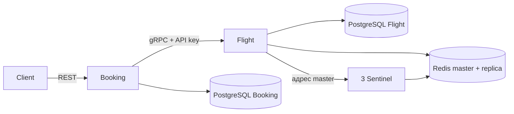

# Flight Booking

Booking принимает REST-запросы и вызывает Flight по gRPC. У сервисов отдельные
PostgreSQL. Flight хранит рейсы и резервы, Redis кеширует рейсы и результаты поиска.



## Запуск

Команды выполняются из `dz3`.

```sh
docker compose up --build -d --wait --wait-timeout 180
curl http://localhost:8090/health
```

Миграции Flyway применяются при старте. В базе есть рейс `SU1234`, SVO → LED,
на 1 апреля 2030 года: 10 мест по 1250 рублей.

| Интерфейс | Адрес |
|---|---|
| Booking REST | `localhost:8090` |
| Flight gRPC | `localhost:50061` |
| PostgreSQL Flight | `localhost:55431`, база/пользователь/пароль `flight` |
| PostgreSQL Booking | `localhost:55432`, база/пользователь/пароль `booking` |

Настройки и ключ для учебного стенда: [.env.example](.env.example).
Чтобы изменить значения, скопируйте файл в `.env`. API key передается в gRPC metadata
`x-api-key`; Flight проверяет его на каждом RPC. HTTP принимает `user_id` из запроса,
пользовательская авторизация в этом задании не предусмотрена. gRPC внутри сети Compose
работает без TLS; опубликованные порты доступны только с локальной машины.

Логи: `make logs`. Остановка с сохранением данных: `make down`.

## API

[OpenAPI](api/openapi.yaml) · [gRPC-контракт](proto/flight/v1/flight.proto) ·
[Поведение RPC и ошибки](proto/flight/v1/README.md) · [ER и ограничения](docs/er.md)

| Метод | Назначение |
|---|---|
| `GET /flights?origin=SVO&destination=LED&date=2030-04-01` | Поиск SCHEDULED-рейсов; дата необязательна |
| `GET /flights/{id}` | Информация о рейсе |
| `POST /bookings` | Создание бронирования |
| `GET /bookings/{id}` | Получение бронирования |
| `GET /bookings?user_id=UUID` | Бронирования пользователя |
| `POST /bookings/{id}/cancel` | Отмена бронирования |

```sh
curl 'http://localhost:8090/flights?origin=SVO&destination=LED&date=2030-04-01'
curl -X POST http://localhost:8090/bookings \
  -H 'Content-Type: application/json' \
  -H 'Idempotency-Key: 33333333-3333-4333-8333-333333333333' \
  -d '{"user_id":"22222222-2222-4222-8222-222222222222","flight_id":"11111111-1111-4111-8111-111111111111","passenger_name":"Ivan Ivanov","passenger_email":"ivan@example.com","seat_count":2}'
curl -X POST http://localhost:8090/bookings/33333333-3333-4333-8333-333333333333/cancel
```

`Idempotency-Key` — необязательный UUID будущего бронирования. Повтор с тем же ключом
и телом возвращает сохраненный результат; другое тело дает 409. Без заголовка каждый
запрос получает новый UUID. Для нового бронирования после отмены нужен новый ключ.
Цены в REST — строки с двумя знаками, в protobuf и БД — целые копейки. Даты поиска
и уникальность номера рейса за день определяются в UTC.

Booking вызывает `GetFlight`, затем `ReserveSeats`, сохраняет `CONFIRMED` и
`total_price = seat_count × price`. Изменение цены Flight не меняет этот снимок.
Flight блокирует строку рейса через `SELECT FOR UPDATE`; изменение остатка и резерва
происходит в одной транзакции. Повторное резервирование с тем же `booking_id`
не списывает места второй раз. Повторная отмена также безопасна.

Если ответ о резервировании потерян или запись Booking не удалась, журнал операций
обеспечивает возврат мест. Worker продолжает компенсацию после перезапуска. До ее
завершения возможен резерв без бронирования. Ответ `503 OPERATION_PENDING` содержит
`booking_id`: проверяйте `GET /bookings/{id}` или повторите запрос с прежним ключом.
`404` во время восстановления не доказывает, что операция уже завершена.

## Кеш и сбои

Cache-aside: Redis → при промахе PostgreSQL → запись в Redis на 5 минут.
Ключи: `flight:{id}`, `search:{origin}:{destination}:{date|all}`.
`ReserveSeats`, `ReleaseReservation`, `UpdateFlight` удаляют затронутые ключи.
Версия данных хранится в PostgreSQL и сверяется при попадании в кеш: запоздалое
заполнение или продвижение реплики не позволяют выдать старый результат. Это один
короткий запрос версии к БД на cache hit; данные рейсов и поисковые выборки берутся
из Redis. Если Redis недоступен, Flight читает PostgreSQL.

Sentinel выбирает новый master; `go-redis` получает его адрес автоматически.
Три Sentinel и две Redis-ноды работают на одном Docker-хосте: стенд позволяет
проверить отказ контейнера, но не отказ всего хоста.

Booking делает максимум три попытки RPC, с задержками 100 и 200 мс. Повторяются
только `UNAVAILABLE` и `DEADLINE_EXCEEDED`; у каждой попытки deadline 2 секунды.
Идемпотентность по `booking_id` защищает мутации при потерянном ответе.

Circuit breaker работает в клиентском interceptor поверх повторов. После пяти
последовательных транспортных ошибок в окне 30 секунд он открывается на 15 секунд
и возвращает `503 CIRCUIT_OPEN` без вызова Flight. Затем допускает один пробный
запрос. Доступность сервиса возвращает breaker в CLOSED; транспортная ошибка — в OPEN.
Бизнес-ошибки не увеличивают счетчик сбоев. Параметры задаются через окружение.
Логи JSON содержат cache hit/miss, попытки RPC, переходы breaker и восстановление.

## Проверки

Для локальной сборки нужны Go 1.26 и `protoc`. Генерация ogen/protobuf выполняется
при сборке; сгенерированные файлы исключены из Git.

```sh
make build
make check
make e2e
```

`make check` запускает unit-тесты, race detector и vet. Для тестов БД задайте
`TEST_FLIGHT_DATABASE_URL` и `TEST_BOOKING_DATABASE_URL`; для тестов кеша также
`TEST_REDIS_ADDR` отдельного Redis. Тесты БД создают изолированные схемы.

`make e2e` требует запущенный Compose. Он выполняет REST/gRPC-запросы, выводит
SELECT, проверяет остатки, снимок цены, идемпотентность и кеш. В ходе проверки
останавливаются Flight и Redis master, принудительно завершается Booking после
резервирования мест; затем проверяются восстановление и circuit breaker.
Запускайте сценарии на этом учебном Compose-проекте без параллельных клиентов.

Основной код: [Flight](internal/flight), [Booking и recovery](internal/booking),
[retry, breaker, auth](internal/transport), [REST](internal/httpapi).

Документация технологий: [gRPC retry](https://grpc.io/docs/guides/retry/),
[Redis Sentinel](https://redis.io/docs/latest/operate/oss_and_stack/management/sentinel/).
