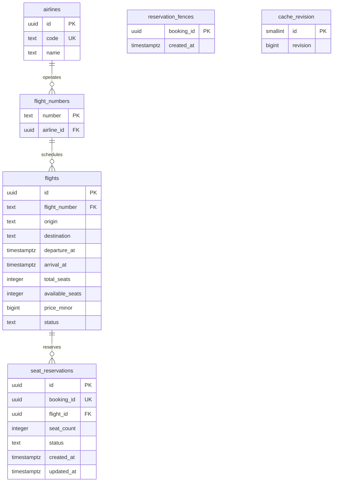
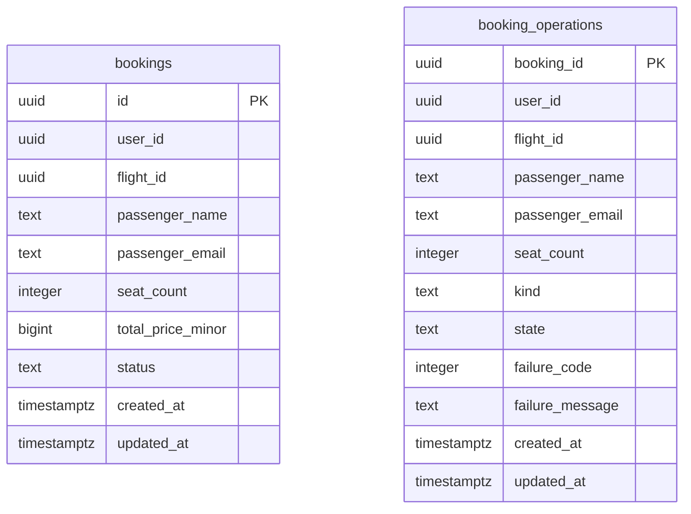

# Схема данных

Flight и Booking используют разные PostgreSQL. `booking_id` в Flight и `flight_id`
в Booking — межсервисные ссылки, проверяемые приложением; SQL FK между базами нет.

## Flight

Комбинация `flight_number` и UTC-даты `departure_at` уникальна.
Коды аэропортов состоят из трех заглавных латинских букв; аэропорты вылета и прилета
различаются. `arrival_at > departure_at`, `total_seats > 0`,
`0 <= available_seats <= total_seats`, `price_minor > 0`, `seat_count > 0`.

Статусы рейса: SCHEDULED, DEPARTED, CANCELLED, COMPLETED.
Статусы резерва: ACTIVE, RELEASED, EXPIRED. Незавершенные операции возвращают места через компенсацию.
`booking_id UNIQUE` гарантирует не более одной резервации для бронирования.
`reservation_fences` запрещает запоздалое резервирование после возврата мест.
`cache_revision` содержит одну строку и меняется вместе с данными рейсов.

Авиакомпания вынесена в отдельную таблицу; номер рейса ссылается на нее, а конкретный
вылет — на номер рейса. Название авиакомпании не дублируется в каждом вылете.
В каждой таблице неключевые атрибуты зависят от ключа, нет транзитивной зависимости
между неключевыми атрибутами. Схема соответствует 3NF.

## Booking

`bookings.id` совпадает с `booking_operations.booking_id`. Журнал появляется раньше
бронирования, поэтому FK от журнала к `bookings` отсутствует. Запись бронирования и
завершение CREATE фиксируются одной локальной транзакцией.

Статусы бронирования: CONFIRMED, CANCELLED. Журнал хранит CREATE/CANCEL и
PENDING/DONE/FAILED. Данные пассажира относятся к конкретному бронированию:
пользователь может покупать билеты для разных пассажиров. Поэтому они не зависят
функционально от `user_id`. Полная цена — снимок результата покупки; текущая цена
рейса хранится только во Flight. Ограничения: 1–999 мест, положительная сумма,
имя 1–255 символов, email до 254 символов. Схема соответствует 3NF.
