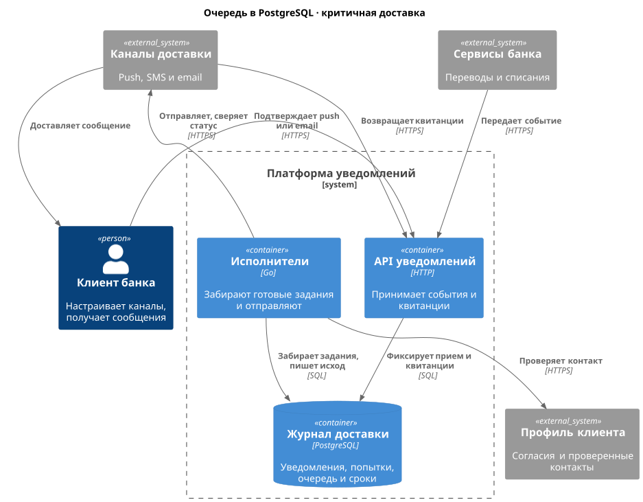
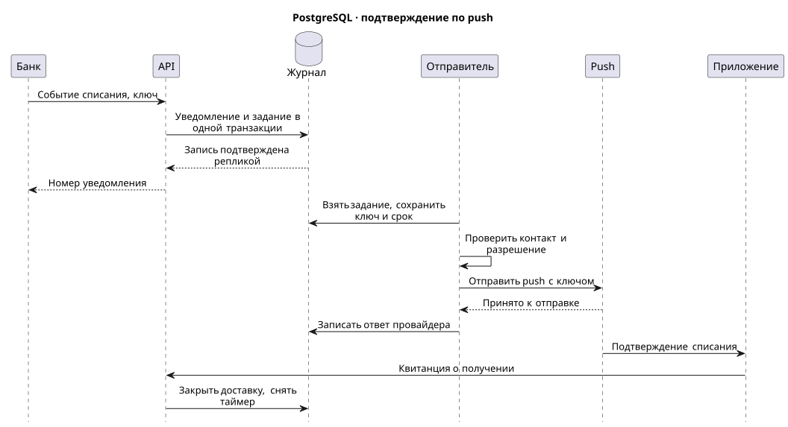
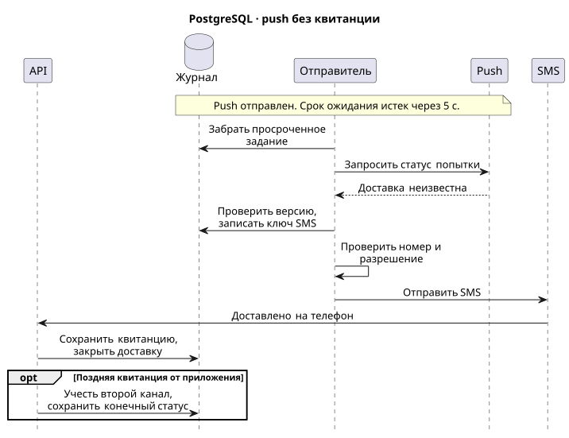
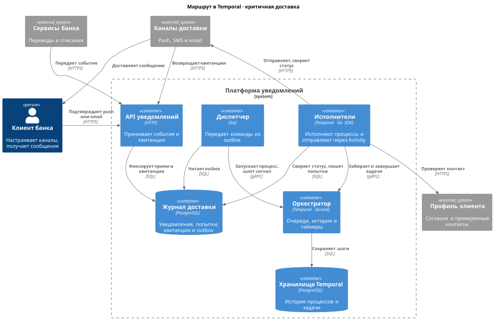
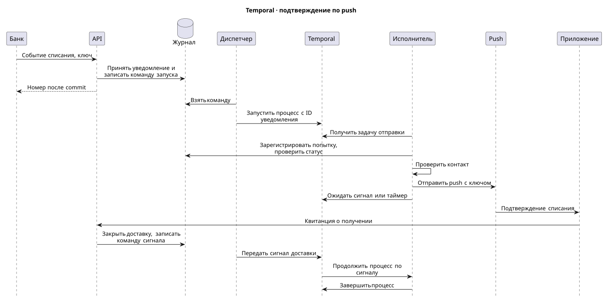
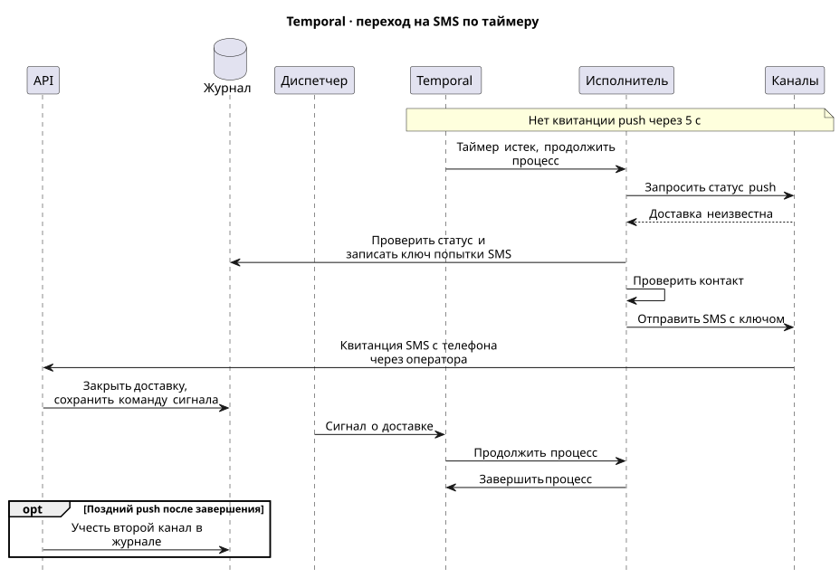

# RFC. Доставка критичных уведомлений с автоматическим переключением каналов

| Метаданные | Значение |
|---|---|
| Статус | DESIGN |
| Автор | Арсений Курин |
| Ответственный | Команда платформы уведомлений |
| Бизнес-заказчик | Розничный онлайн-банк |
| Ревьюеры | Команды переводов, поддержки и эксплуатации|
| Дата создания | 2026-11-16 |

## Оглавление

[Контекст](#контекст) · [Продуктовый анализ](#продуктовый-анализ) · [Пользовательские сценарии](#пользовательские-сценарии) · [Статистика](#статистика) · [Требования](#требования) · [Варианты решения](#варианты-решения) · [Сравнительный анализ](#сравнительный-анализ) · [Выводы](#выводы) · [Связанные задачи](#связанные-задачи) · [Приложения](#приложения)

## Контекст

Клиент перевел деньги и ждет подтверждение. Push-провайдер принял запрос, но телефон может быть вне сети. Банку нужно решить, когда переходить на SMS, как узнать о доставке и кто займется случаем, если все контакты недоступны. RFC охватывает подтверждения уже совершенных операций. Отправка уведомления не задерживает перевод.

## Продуктовый анализ

| Цель | Как банк проверит результат |
|---|---|
| Удержание +15% | D30 — доля клиентов когорты, открывших банк на 30-й день. Сравнить с одновременной случайной контрольной группой по отношению долей. Обе группы получают критичные сообщения. Варианты сервисных и рекламных уведомлений тестируются отдельно. |
| Жалобы −30% | За одинаковые 30 дней сравнить группы по числу жалоб на 10 тыс. уникальных адресатов. Отдельно посчитать задержки, дубли и рекламу после отписки. |
| Доставка критичных сообщений | По каждой операции сверить событие банка с журналом доставки. Измерять долю квитанций к 5 и 120 с, число неподтвержденных случаев и стоимость на одну подтвержденную доставку. |

## Пользовательские сценарии

| Приоритет | Тип сценария | Участник | Сценарий и результат |
|---|---|---|---|
| MUST | Оплата | Клиент | После покупки приложение подтверждает получение push. Банк завершает доставку без расходов на SMS. |
| MUST | Резервный канал | Клиент вне сети | По истечении срока ожидания банк отправляет SMS на подтвержденный номер. Квитанция оператора закрывает уведомление. |
| MUST | Выбор канала | Клиент | Клиент отключил рекламу и указал SMS первым каналом для операций. Подтверждение списания приходит по SMS. Платформа исключает клиента из ожидающей рекламной рассылки. |
| MUST | Разбор обращения | Сотрудник поддержки | По переводу без квитанции видит время каждой попытки, ответ провайдера и открытый случай. Поздняя квитанция обновляет его статус. |

## Статистика

По условию у банка 10 млн MAU, 3 млн DAU и до 300 тыс. клиентов онлайн одновременно. Для расчета принимаем, что суточная норма относится к активному клиенту. Число одновременных сессий само по себе не задает частоту операций.

| Тип | На клиента в день | В сутки | В среднем за секунду |
|---|---:|---:|---:|
| Транзакционные | 2 | 6 млн | 69 |
| Сервисные | 3 | 9 млн | 104 |
| Маркетинговые | 5 | 15 млн | 174 |
| Всего | 10 | 30 млн | 347 |

**Расчет нагрузки.** 30 млн / 86 400 ≈ 347 уведомлений/с. Для проектирования берем десятикратный пик и добавляем отдельную кампанию на 1 млн за 30 мин. Получаем 3 472 + 556 ≈ 4 028/с. Округляем целевую мощность до 4 100/с, из них 700/с критичных. Это консервативное наложение кампании на обычный маркетинговый поток. Коэффициент пика предстоит измерить.

Если 5% критичных сообщений переходят с push на SMS, банк отправит около 300 тыс. SMS в день. При цене одной SMS *c* суточный расход составит *300 000 × c*. При полном отказе push на пике потребуется до 700 SMS/с только для операций, если все эти клиенты доступны по SMS. В этом режиме 700 первых и 700 резервных попыток дают до 1 400 обращений/с для критичного потока при разовой отправке по каждому из двух каналов. Повторы и третий канал проверяем отдельным прогоном. За 30 дней накопится 180 млн критичных уведомлений без учета попыток и квитанций.

## Требования

### Функциональные требования

| Приоритет | Требование платформы | Что должна делать подсистема |
|---|---|---|
| MUST | F1, F4 | Принимать событие перевода или списания с устойчивым ключом. Повтор возвращает тот же номер уведомления. |
| MUST | F2, F3 | Выбирать доступный подтвержденный контакт с учетом предпочтения клиента. При отказе или истечении срока ожидания выбирать следующий канал. |
| MUST | F6 | Принимать квитанции, останавливать дальнейшую отправку и передавать неподтвержденные случаи поддержке. |
| MUST | F5 | Сохранять отдельные разрешения для рекламы и сервисных сообщений. Рекламная кампания не может использовать класс транзакционных сообщений. |

### Нефункциональные требования

| Приоритет | ASR и требования платформы | Приемка подсистемы |
|---|---|---|
| MUST | A1 · N1, N2 | При пике 4 100/с с учетом кампании ≥95% критичных доставок подтверждены за 5 с, ≥99,9% за 120 с. |
| MUST | A2 · N1, N3, N5 | После потери зоны все принятые заявки учтены, обработка возобновлена за 60 с. История доступна 30 дней. Просроченный случай появляется у дежурного к 180-й секунде. |
| MUST | A3 · N4 | Повтор события возвращает один ID. За месяц ≤0,1% критичных уведомлений имеют квитанции от двух каналов. |
| MUST | A4 · N6 | Новые передачи рекламы прекращаются в течение 5 с после отписки. Для операций на пилоте сравниваются доля SMS и стоимость подтвержденной доставки при соблюдении N1. |

Определения F1–F6 и N1–N6 приведены в [требованиях платформы](README.md).

### Правила доставки для обоих вариантов

1. **Прием.** Банк сохраняет событие в исходящей таблице вместе с операцией. Отправитель повторяет передачу до ответа платформы. Сроки N1 и N5 отсчитываются от времени операции в событии. Платформа подтверждает прием после записи на основной узел и хотя бы одну синхронную реплику. Три узла размещаются в трех зонах. Ключ — система-источник, ID события, клиент и назначение. Ключи хранятся 30 дней. Более старые события из выгрузок направляются на сверку без автоматической отправки.
2. **Маршрут.** Клиент выбирает первый канал. По умолчанию порядок — push, SMS, email. Клиент может отключить канал, пока у него остается подтвержденный контакт для операций. Перед каждой передачей отправитель проверяет актуальность контакта и настройки. Если контакт отозван, переходит к следующему. При недоступности настроек отправка ждет восстановления, срок контроля продолжает идти.
3. **Квитанция.** Для push банк принимает подтверждение от авторизованного приложения о получении сообщения. Для SMS — заверенный оператором отчет о доставке на телефон. Для email — явное подтверждение клиента по ссылке после входа в банк. Ответ API «принято» и прием письма почтовым сервером оставляют попытку в ожидании. Метрика подтверждает получение на указанной границе, прочтение SMS остается неизвестным.
4. **Переключение.** При постоянном отказе отправитель сразу выбирает следующий разрешенный канал. При потере ответа сверяет статус по ключу попытки. Если квитанция не пришла, отправитель переходит дальше через 5 с для push, 20 с для SMS, 30 с для email от начала соответствующей попытки. Сроки стартовые, для пилота. Каждый канал проходит один раз за цикл. После исчерпания каналов платформа открывает случай для поддержки. До 24 ч она сверяет неизвестные исходы и повторяет отправки после подтвержденных временных отказов с интервалами от 1 до 15 мин. Если к 120-й секунде квитанции нет, случай открывается даже при оставшихся попытках. Через 24 ч автоматические отправки прекращаются, случай остается у поддержки до разбора.
5. **Дубли и поздние ответы.** У одной попытки постоянный ключ. Повтор запроса после тайм-аута допустим с этим ключом, только если провайдер устраняет дубли в пределах всего окна повтора. Иначе банк сверяет статус и переходит к резервному каналу. Обработчик квитанции проверяет ее подлинность, связывает с попыткой и сохраняет один раз по ID квитанции. Первая положительная квитанция любого канала закрывает доставку и отменяет ожидающие задания. Поздний отказ ее не переоткрывает. Вторая положительная квитанция остается в журнале для учета дублей. Уже переданная SMS может дойти после закрытия.
6. **Граница гарантии.** Для каждой принятой заявки банк сохраняет либо квитанцию, либо открытый случай с историей попыток. Доставка хотя бы по одному каналу возможна, если контакт и провайдер доступны в срок отправки. При отключенном телефоне и недоступной почте банк может гарантировать сохранность заявки и разбор. Такие случаи входят в знаменатель N1. Перепроверка статуса уменьшает число дублей, но два независимых канала могут оба показать сообщение.
7. **Контроль.** В журнале хранятся ID операции и попытки, канал, сроки, код результата и время квитанции. Поддержка видит замаскированный адрес. Метрики Prometheus показывают возраст очереди, долю доставок к сроку, переходы между каналами, дубли и платные попытки. Дежурный получает сигнал о просрочке через Alertmanager. Текст сообщения и контакты исключены из меток и трасс OpenTelemetry. Отправитель банка поднимает тревогу по событиям, которые платформа не приняла за 120 с. Ежедневная сверка выявляет расхождения между журналом и операциями.

## Варианты решения

### Вариант 1. Очередь и журнал в PostgreSQL

#### Архитектура

Входной API в одной транзакции записывает уведомление и срок первой попытки. Для критичных сообщений выделены кластер PostgreSQL с синхронной репликой, пул отправителей и квоты. Массовые рассылки работают в своем кластере и пуле. Очередью служит таблица заданий со временем следующей попытки. Внешний брокер не требуется.

Отправитель выбирает готовые задания через `FOR UPDATE SKIP LOCKED`, сохраняет ключ попытки и аренду задания, затем завершает транзакцию до вызова провайдера. После падения исполнителя другой забирает просроченную аренду и сверяет неопределенную попытку. Таймер и квитанция обновляют запись под блокировкой с проверкой версии. Перед внешним вызовом отправитель еще раз проверяет, что попытка актуальна. Таблицы истории делятся по дате, индекс очереди содержит только ожидающие задания. [Выборка заданий в PostgreSQL](https://www.postgresql.org/docs/current/sql-select.html#SQL-FOR-UPDATE-SHARE)

#### Этапы реализации

Оценки предполагают двух разработчиков и участие инженера эксплуатации.

| Этап | Срок | Участники | Основной риск |
|---|---|---|---|
| Прием, очередь, журнал, основной push | 2 недели | 2 разработчика | Задания конкурируют за индекс |
| Резервные каналы, квитанции и пилот с отказом зоны | 2 недели | Та же команда и инженер эксплуатации | Очистка истории замедляет обработку очереди |

#### Преимущества

Прием заявки и планирование отправки фиксируются одним commit. Поддержка видит состояние в том же журнале.

#### Недостатки

Команда отвечает за таймеры, аренду и восстановление незавершенных попыток. Запас производительности PostgreSQL потребует измерения.

### Вариант 2. Процесс доставки в Temporal

#### Архитектура

API сохраняет уведомление и команду запуска в исходящей таблице PostgreSQL. Диспетчер повторяет запуск с тем же Workflow ID, равным номеру уведомления. Уникальный ключ входного события защищает и после завершения процесса. Очереди задач, таймеры и историю шагов хранит кластер Temporal с собственной PostgreSQL. Обе БД используют синхронную реплику в другой зоне. Отправители критичных и массовых сообщений читают отдельные очереди Temporal с отдельными пулами и квотами. [Очереди задач](https://docs.temporal.io/task-queue) · [Workflow ID](https://docs.temporal.io/workflow-execution/workflowid-runid)

Внешний вызов выполняет Activity с устойчивым ключом попытки. Обработчик сначала записывает квитанцию и исходящую команду в журнал. Диспетчер передает ее процессу сигналом и повторяет при сбое. Процесс выбирает следующий канал, когда сработал таймер или пришел отказ. Перед отправкой Activity проверяет журнал на позднюю доставку. Диспетчер передает команду повторно с тем же Workflow ID. Пока хранится история процесса, политика Reject Duplicate запрещает второй запуск даже после завершения первого. [Внешние действия в Temporal](https://docs.temporal.io/activities)

#### Этапы реализации

Оценка предполагает самостоятельное размещение Temporal банком.

| Этап | Срок | Участники | Основной риск |
|---|---|---|---|
| Кластер, прием и процесс с таймерами | 3 недели | 2 разработчика и инженер эксплуатации | Восстановление кластера и его хранилища |
| Каналы, доставка сигналов, пилот и обновление работающих процессов | 2 недели | Та же команда | Расхождение журнала поддержки и истории процесса |

#### Преимущества

Движок восстанавливает таймеры и ход процесса после остановки исполнителя.

#### Недостатки

Банку нужно обслуживать отдельный кластер и согласовывать его историю с журналом квитанций. Повтор внешней Activity по-прежнему требует поддержки идемпотентности у провайдера.

## Сравнительный анализ

### Ресурсные требования

| Критерий | Очередь в PostgreSQL | Temporal |
|---|---|---|
| Срок и команда | Около 4 недель, 2 разработчика с участием эксплуатации | Около 5 недель, 2 разработчика и инженер эксплуатации |
| Инфраструктура | API, отправители, PostgreSQL, изолированные ресурсы для массового потока | API, диспетчер, отправители, журнал PostgreSQL, кластер Temporal с хранилищем |
| Риск для дежурной смены | Истекшая аренда и растущий возраст очереди | Задержка сигналов и несовместимость новой версии процесса с уже начатыми |

### Соответствие требованиям

| ASR | Очередь в PostgreSQL | Temporal |
|---|---|---|
| A1 · F1, F5, N1, N2 | Выделенный кластер, исполнители и квота. На пике измерить возраст старейшего задания. | Отдельные Task Queues, исполнители и квота. Замерить задержку постановки и подбора задачи при общей нагрузке на кластер. |
| A2 · F3, F6, N1, N3, N5 | Синхронная реплика, время следующего шага и журнал в одной БД. Проверить перехват аренды и сигнал на 120-й секунде. | Синхронное хранение, устойчивые таймеры и повтор сигналов из журнала. Остановить обработчики и проверить продолжение с последнего шага. |
| A3 · F3, F4, N4 | Уникальность события, ключ попытки и версия строки упорядочивают решения таймера и квитанции. | Workflow ID, последовательная обработка событий и ключ Activity ограничивают повтор одной операции. |
| A4 · F2, F5, N6 | Отправитель перечитывает настройки перед вызовом и учитывает платную попытку. | Activity перечитывает настройки при каждом внешнем вызове и пишет стоимость попытки в журнал. |

## Выводы

Для первого запуска выбираем PostgreSQL. В маршруте три канала, один срок ожидания на попытку и одно условие завершения. Банк может атомарно принять заявку и поставить ее в очередь, а поддержка — найти попытки и квитанции одним запросом. Цена выбора — собственные таймеры и восстановление аренды.

Перед запуском воспроизводим пик в 4 100 уведомлений/с, включая кампанию, затем отключаем зону и отдельно проверяем отказ push при согласованной квоте SMS. Проверяем N1–N6, в том числе случай, когда провайдер принял запрос и оборвал соединение. Если обработка таймеров и повторов исчерпает бюджет задержки при достаточной квоте провайдеров, прогоним тот же профиль в Temporal и сравним результаты.

## Связанные задачи

1. Команды переводов и поддержки согласуют ключ события, смысл каждой квитанции и порядок разбора через 24 ч.
2. Владелец каналов подтверждает квоты, тарифы, окно идемпотентности и возможность запроса статуса по ключу.
3. Команда платформы проводит пилот на списаниях, измеряет задержки и стоимость. При откате новые события возвращаются на прежний маршрут, а уже принятые платформой уведомления она доводит до квитанции или разбора.

## Приложения

### Глоссарий

| Термин | Значение |
|---|---|
| Квитанция | Свидетельство получения, установленное отдельно для push, SMS и email. |
| Попытка | Одна логическая отправка уведомления через конкретного провайдера. Повторы сетевого запроса сохраняют ее ключ. |
| Failover | Переход к другому разрешенному каналу после отказа или истечения срока ожидания. |
| RPO | Допустимая потеря принятых данных при восстановлении. |
